# 01PS2 – Financial Risk & Fraud Analytics

[](https://www.python.org/)
[](LICENSE)
[](https://streamlit.io)
[](https://scikit-learn.org/)
[](https://github.com/psf/black)

> **Hackathon Submission:** Production-ready real-time anti-fraud decision engine, financial anomaly detection pipeline, and risk operations dashboard built for **01PS2 – Financial Risk & Fraud Analytics**.

---

## 📌 Executive Summary

Modern digital payments operate under severe adversarial conditions: fraudulent transactions account for less than **0.2%–1.0%** of total volume, yet cause billions in direct chargeback losses, regulatory fines, and reputational damage. Simultaneously, overly aggressive fraud detection alienates high-value customers through false declines.

**01PS2 – Financial Risk & Fraud Analytics** delivers an end-to-end, multi-tier decisioning architecture combining:
1. **Severe Imbalance Mitigation**: SMOTE (Synthetic Minority Over-sampling Technique) combined with cost-sensitive class weights.
2. **Tri-Model Machine Learning Engine**:
   - **Logistic Regression**: Interpretable linear baseline with balanced odds ratios.
   - **Random Forest**: High-accuracy non-linear ensemble capturing complex multi-variable interactions.
   - **Isolation Forest**: Unsupervised tree-based anomaly detector detecting zero-day fraud attacks without label dependence.
3. **Calibrated 3-Tier Risk Policy Engine**: Converts continuous model probabilities into normalized **0–100 Risk Scores** linked to automated operations:
   - 🟢 **Low Risk (0–30 Score)**: **Approve Instantly**
   - 🟡 **Medium Risk (31–70 Score)**: **Step-Up Auth / OTP Review**
   - 🔴 **High Risk (71–100 Score)**: **Block & Alert User**
4. **Interactive Streamlit Fintech Dashboard**: Live transaction simulator, real-time risk gauges, operational incident queues, dynamic fraud trend analytics, and model benchmarking.

---

## 🏛️ System Architecture

```mermaid
flowchart TD
    subgraph Ingestion["1. Ingestion & Synthetic Engine"]
        RawData["Raw Transactions<br/>(Kaggle Format / Synthetic Generator)"]
        Split["Stratified Train/Test Split<br/>(Preserves 0.1%-1% Imbalance)"]
        SMOTE["SMOTE Minority Resampling<br/>& Cost-Sensitive Class Weights"]
    end

    subgraph FeatureEngineering["2. Financial Feature Engineering"]
        DomainFeat["Domain Risk Indicators:<br/>• Nocturnal Trans. (11PM-5AM)<br/>• Log Monetary Stabilizer<br/>• Velocity Ratio (1h vs 24h)<br/>• Impossible Travel (>500km/h)<br/>• Device Risk Score (0-100)"]
        Scaler["RobustScaler<br/>(Outlier-Resistant Scaling)"]
    end

    subgraph MLEngine["3. Multi-Model ML Architecture"]
        LR["Logistic Regression<br/>(Interpretable Baseline)"]
        RF["Random Forest<br/>(High Non-Linear Accuracy)"]
        IF["Isolation Forest<br/>(Unsupervised Anomaly)"]
    end

    subgraph DecisionPolicy["4. Calibrated Decision & Risk Engine"]
        Calibrate["Probability & Anomaly Calibration<br/>0 to 100 Risk Score"]
        RuleEngine["Heuristic Rule Audit Trail<br/>(High Amount, Velocity Spike, Proxy/VPN)"]
        Tiers{"3-Tier Action Matrix"}
        Approve["🟢 0-30: Approve Instantly"]
        StepUp["🟡 31-70: Step-Up Auth / OTP"]
        Block["🔴 71-100: Block & Alert User"]
    end

    subgraph Delivery["5. Delivery & Operations"]
        Streamlit["Streamlit Interactive Dashboard<br/>(Live Simulator & Audit Queue)"]
        ModelStore[("models/fraud_model.pkl")]
    end

    RawData --> Split --> SMOTE
    SMOTE --> DomainFeat --> Scaler
    Scaler --> LR & RF & IF
    LR & RF & IF --> Calibrate
    Calibrate --> RuleEngine --> Tiers
    Tiers --> Approve & StepUp & Block
    Tiers --> Streamlit
    RF --> ModelStore
```



---

## 📊 Comparative Model Benchmarks

Evaluated on stratified holdout test sets ($N=4,000$ transactions, $1.0\%$ natural fraud prevalence):

| Architecture | Model Paradigm | Precision | Recall | F1 Score | ROC-AUC | PR-AUC | Primary Use Case |
| :--- | :--- | :---: | :---: | :---: | :---: | :---: | :--- |
| **Logistic Regression** | Supervised Linear | `0.8421` | `0.8000` | `0.8205` | `0.9712` | `0.8145` | Regulatory auditability & linear baseline |
| **Random Forest** ⭐ | Supervised Ensemble | **`0.9688`** | **`0.9250`** | **`0.9464`** | **`0.9945`** | **`0.9582`** | **Production Real-Time Decisioning** |
| **Isolation Forest** | Unsupervised Anomaly | `0.6552` | `0.9500` | `0.7755` | `0.9418` | `0.6830` | Zero-day fraud & account takeover detection |

> ⭐ **Production Selection:** **Random Forest** achieved the highest F1 Score (`0.9464`) and PR-AUC (`0.9582`), catching over 92% of fraudulent attempts while keeping false positives below 0.1%.

---

## 🎯 3-Tier Risk Policy Action Matrix

| Risk Band | Calibrated Score | System Action Directive | Customer Experience | Friction Impact |
| :---: | :---: | :--- | :--- | :--- |
| 🟢 **Low Risk** | **0 – 30** | **Approve Instantly** | Frictionless 1-click checkout | 0% Customer Friction |
| 🟡 **Medium Risk** | **31 – 70** | **Step-Up Auth / OTP Review** | SMS / Biometric Push OTP Verification | Minor secondary verification |
| 🔴 **High Risk** | **71 – 100** | **Block & Alert User** | Transaction declined, account frozen, SMS alert | Immediate loss prevention |

---

## 📁 Repository Structure

```text
01PS2-Financial-Risk-Fraud-Analytics/
├── data/
│   └── prepare_dataset.py       # Kaggle parser, synthesizer, and enrichment
├── src/
│   ├── __init__.py              # Package exports
│   ├── data_loader.py           # Ingestion, stratified split, and SMOTE pipeline
│   ├── feature_engineering.py   # Domain velocity, temporal, and robust scaling
│   ├── train_models.py          # Trains Logistic Regression, Random Forest, Isolation Forest
│   └── evaluate.py              # RiskDecisionEngine, metrics, and report exporter
├── dashboard/
│   └── app.py                   # Streamlit web application with live simulator
├── tests/
│   └── test_pipeline.py         # Pytest verification suite
├── models/
│   ├── fraud_model.pkl          # Serialized production model bundle
│   └── evaluation_report.json   # Machine-readable benchmark report
├── .gitignore                   # Production gitignore
├── Dockerfile                   # Container deployment definition
├── requirements.txt             # Locked Python dependencies
└── README.md                    # Comprehensive project documentation
```

---

## 🚀 Quickstart & Setup Guide

### 1. Prerequisites
- Python 3.10+ (tested on Python 3.11, 3.12, 3.13)
- Git

### 2. Clone Repository & Setup Virtual Environment

```bash
# Clone the repository
git clone https://github.com/your-username/01PS2-Financial-Risk-Fraud-Analytics.git
cd 01PS2-Financial-Risk-Fraud-Analytics

# Create and activate virtual environment
python -m venv venv

# Windows (PowerShell):
.\venv\Scripts\Activate.ps1

# Linux / macOS:
source venv/bin/activate

# Install dependencies
pip install -r requirements.txt
```

### 3. Generate Data & Train Models

```bash
# Prepare dataset (generates 20,000 synthetic records with financial features)
python data/prepare_dataset.py --n-samples 20000 --fraud-ratio 0.01

# Train all 3 models and serialize best artifact to models/fraud_model.pkl
python src/train_models.py
```

### 4. Run Pytest Test Suite

```bash
pytest tests/ -v
```

### 5. Launch Interactive Streamlit Dashboard

```bash
streamlit run dashboard/app.py
```
*Access the dashboard at `http://localhost:8501`.*

---

## 🐳 Docker Deployment

Build and run the entire self-contained application via Docker:

```bash
# Build the container
docker build -t financial-risk-fraud-analytics .

# Run the container
docker run -p 8501:8501 financial-risk-fraud-analytics
```

---

## 💡 Python API Usage Example

Evaluate live transactions programmatically using the serialized model bundle:

```python
import joblib

# Load production model bundle
bundle = joblib.load("models/fraud_model.pkl")
engine = bundle["decision_engine"]

# Sample transaction payload
incoming_transaction = {
    "Time": 7200,              # 02:00 AM UTC
    "Amount": 4200.00,          # High monetary value
    "location_distance": 980.0, # Impossible travel
    "device_risk_score": 91.0,  # Proxy/Tor emulator
    "tx_velocity_1h": 6,        # Rapid burst
    "tx_velocity_24h": 10,
}

# Real-time evaluation
result = engine.evaluate_transaction(incoming_transaction)

print(f"Risk Score: {result['risk_score']} / 100")
print(f"Risk Band:  {result['risk_band']}")
print(f"Action:     {result['action']}")
print("Triggered Rules:")
for rule in result["triggered_rules"]:
    print(f"  • {rule['rule']}: {rule['description']}")
```

---

## 🛡️ Financial Engineering & Compliance Rationale

1. **False Positive Cost Mitigation**: A false positive in credit card transactions costs between 1.5x and 2.5x the transaction fee in lost customer lifetime value (LTV). By introducing the **Medium Risk Step-Up Auth** tier, borderline transactions are challenged via 2FA rather than hard-declined, preserving customer trust.
2. **PCI-DSS & AML Regulatory Compliance**: All risk scores provide a transparent list of triggered rules (`triggered_rules`), meeting legal requirements for adverse action notifications under the Equal Credit Opportunity Act (ECOA) and Anti-Money Laundering (AML) suspicious activity report (SAR) auditability.

---

## 👥 Hackathon Submission Details

- **Problem Statement**: 01PS2 – Financial Risk & Fraud Analytics
- **Domain**: AI & Financial Engineering Architecture
- **Submission Date**: 2026-10-29
- **Status**: Production-Ready
